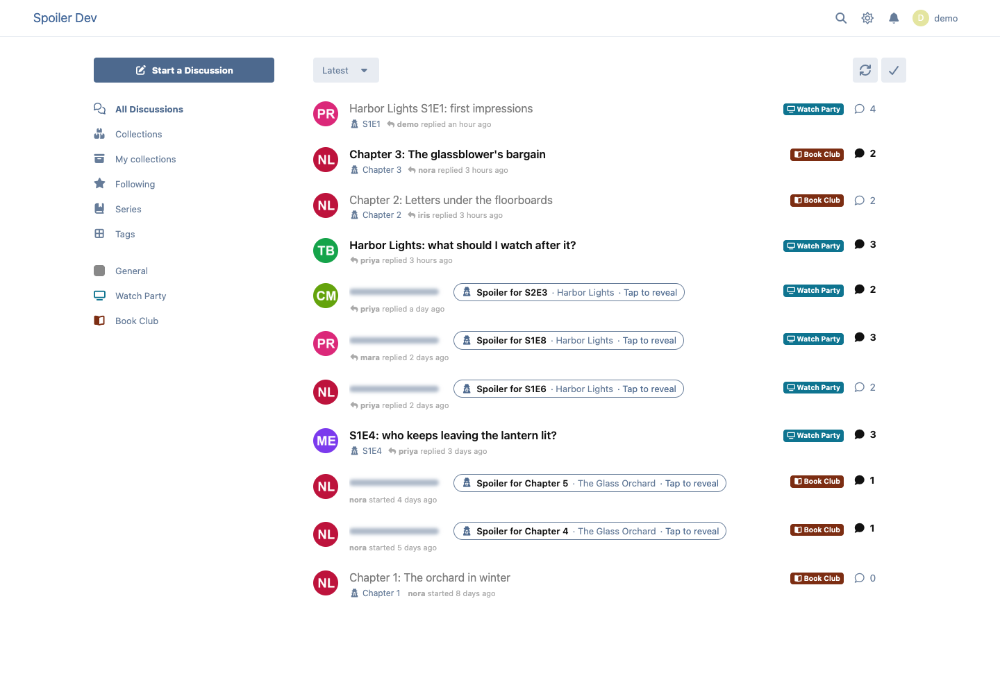
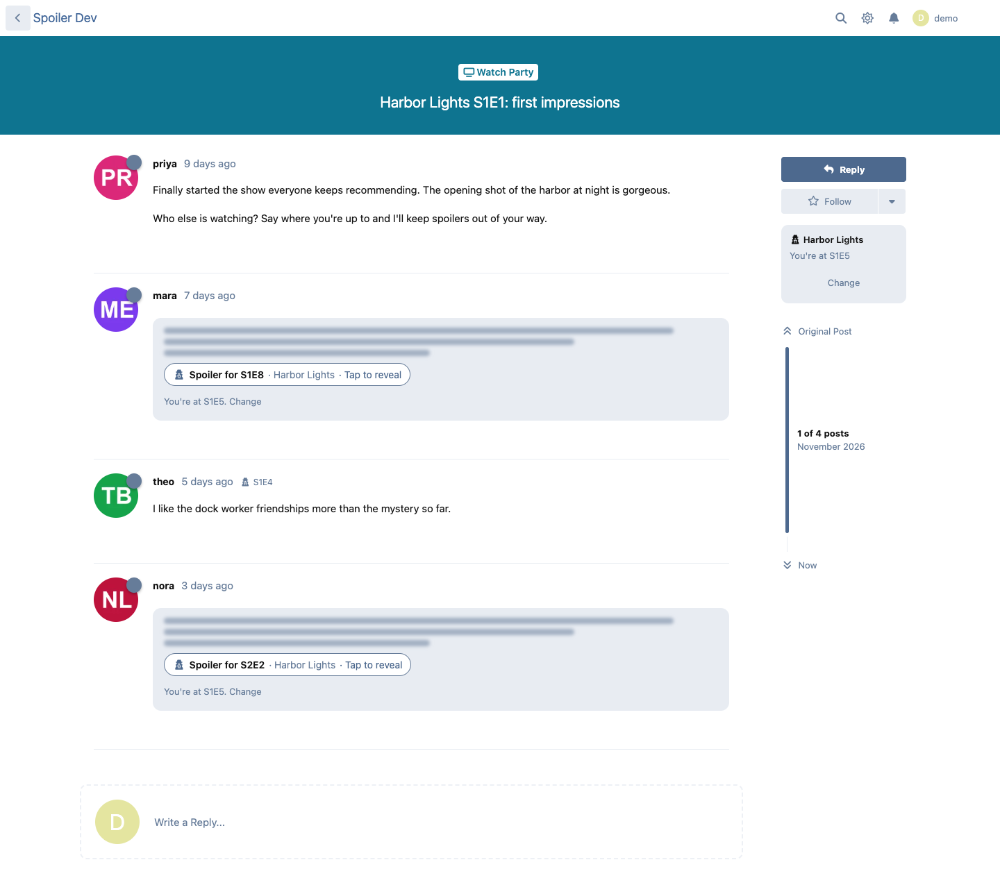
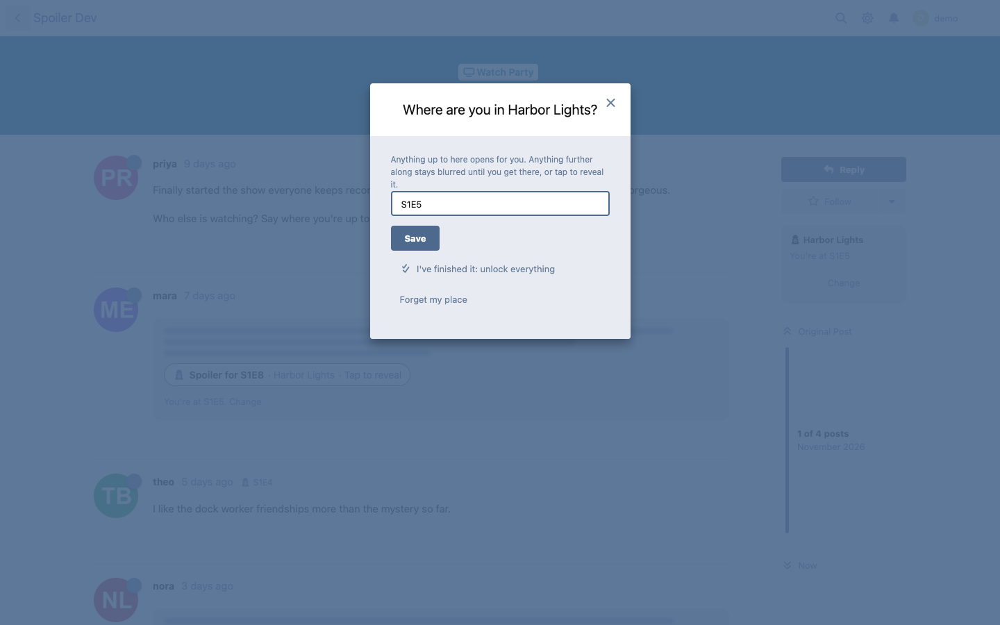

# Spoiler Shield

Discussions and posts gated to each member's progress through a book, show or game, for Flarum 2.



Members say where they're up to ("I'm at S2E3"). Anything further along is blurred in the discussion list, the thread and search results, with a **Spoiler for S2E5 · Tap to reveal** control. Revealing works one item at a time and is remembered. The hidden words never leave the server: they aren't blurred text, they were never sent.

## How it works

- **A work** is a book, show, game or anything else, with an ordered list of parts: chapters, episodes, levels, rounds.
- **Members set their place** per work, from the spoiler control, the discussion page's sidebar, or the **Spoiler progress** page (`/spoilers`, also in the user menu).
- **Discussions are marked** at a place when they're started (the "Spoilers?" chip in the composer), or automatically (below). Anything ahead of you is blurred.
- **Replies are stamped** with their author's place inside a marked discussion, so a reply from someone further along is blurred for people behind. Authors can choose another place, or "nothing past" the discussion's own, from the composer.
- **Guests** see every marked discussion blurred. **Members who haven't said** where they are see what the admin chooses (blurred by default).
- Authors always see their own posts.





## Works from other extensions (all optional)

- **[Marquee](https://github.com/ernestdefoe/marquee)**: a discussion Marquee links to an episode or a season of a show is marked there automatically. The show's seasons and episode counts are the list, so members pick a real episode.
- **[Anthology](https://github.com/ernestdefoe/anthology)**: a series of chapter discussions is a work, and each member's place is what they've read, with nothing to set. The next unread chapter is open (you have to be able to read it); chapters after it, and replies from readers further along, are blurred.
- **[Curio](https://github.com/ernestdefoe/curio)**: a member who marked a title finished or owned in their collection is offered **finished: unlock everything** for that work.

Admins and members (with the permission) can also define their own works, and moderators can attach tags to a work so new discussions there belong to it.

## Privacy

Every API response passes through one check before it leaves the server, including the forum's own page (its title, preloaded data and no-JS content), realtime pushes, notifications, search results and Anthology's chapter list. A hidden discussion keeps only its counts, dates, author and tags: its title becomes "Spoiler for S2E5 (Harbor Lights)", and any other text another extension added is removed. Open Graph, Twitter and description tags are removed from a hidden discussion's page, links that spell out a hidden title are rewritten, and a marked discussion's URL is its place ("/d/12-s2e5"), not its title. Emails that would spoil something aren't sent to that member (their alert still arrives, gated). The tests prove it byte by byte.

## Known limits

Words another extension or a bot copies into its own posts aren't covered: if Claude_Bot quotes a spoiler in a reply of its own, that reply is only blurred if it's marked like any other.

## Install

```
composer require ernestdefoe/spoiler-shield
php flarum migrate
php flarum cache:clear
```

## Links

- [Packagist](https://packagist.org/packages/ernestdefoe/spoiler-shield)
- [GitHub](https://github.com/ernestdefoe/spoiler-shield)

If it keeps your members' evenings unspoiled, you can [buy me a coffee](https://buymeacoffee.com/ernestdefoe) ☕
